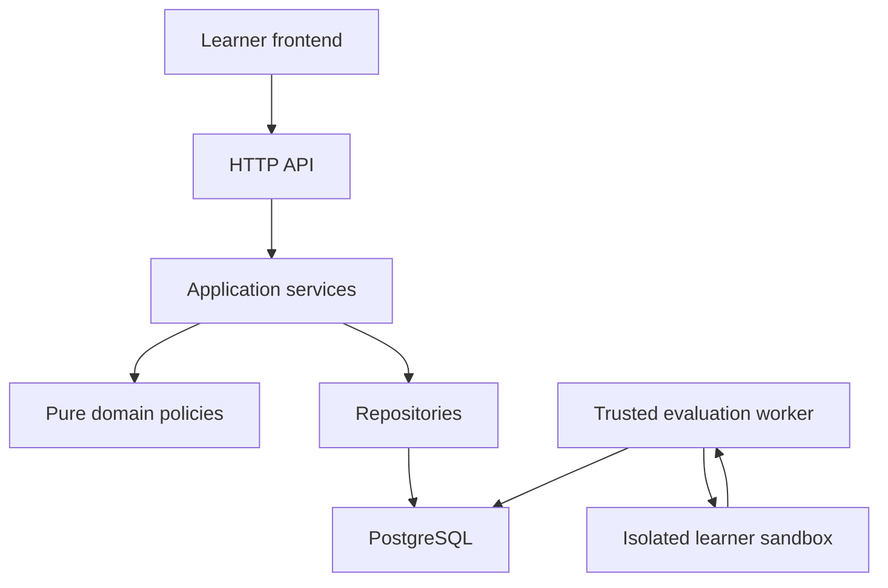

# Python Mastery — Whole-Project Roadmap and Daily Micro-Sprints
Version 1.0 · 12 October 2026 · Aryan Kumar · Timezone: Asia/Kolkata

## Purpose and authority

This roadmap defines the whole agreed product scope, its architecture, release gates, small implementation units, and a three-session daily schedule. It supplements the Master Blueprint, Backend Implementation Contract, REST API Contract and root AGENTS.md. It does not replace refined local contracts or claim access to the current WSL repository.

The source blueprint confirms one complete learning branch before wider expansion. Existing backend reports through B6a are the starting point. Local HEAD and later work must be reconciled in S001. The original documents used earlier B-number meanings; subsequent implementation reports use refined B1–B6a labels. The S001–S114 identifiers below identify future work and avoid renaming historical commits.

Numerical mastery thresholds, timing defaults, question counts and statistical priors remain pilot proposals. The methodology must be tested with observed attempts.

## 1. Finish lines and time interpretation

| Release | Completion meaning | Nominal remaining units | Baseline target if every unit fits its slot |
|---|---|---:|---|
| R0 Local usable platform | One complete dictionary branch: verified publication, browser practice, server timing, staged assistance, real evaluation, evidence, reviews and explainable next choices | S001–S045: 45 | 26 October 2026 |
| R1 Hosted beta | R0 plus real authentication, Bayesian summaries, observed deployment, restore/recovery and operational checks | S001–S060: 60 | 31 October 2026 |
| R2 Core Python product | R1 plus audited coverage of all 18 core language/practical competency areas, with supported task types | S001–S090: 90 | 10 November 2026 |
| R3 AI/interview scope | R2 plus applied AI tasks, selected DSA patterns, isolated SQL tasks and mixed practice | S001–S114: 114 | 18 November 2026 |

There are 114 planned remaining micro-sprints, grouped into 38 daily batches. They include curriculum authoring and product verification, not just code. The baseline includes weekends because the requested cadence is daily.

A micro-sprint is one bounded delivery unit, targeted at 60–120 minutes including its relevant verification and handoff. It is not a formal Scrum sprint. Three per day requires roughly 3–6 focused hours plus breaks and review. A security/backend integration task may exceed that estimate.

These dates are an aggressive allocation, not a delivery promise. They do not shorten the actual engineering effort estimated earlier in larger sprints. Large or ambiguous units are split; failed gates carry forward; later targets move. A release is complete only when its gate passes, even if its date has arrived. No actual delayed retention success is inferred by advancing a simulated clock.

The previous 35% estimate was a rough estimate for the first usable release, not full curriculum completion. Do not turn it into a precise audited percentage. S001 establishes a current inventory; section 12 defines better progress reporting.

## 2. Current reported baseline

| Increment | Reported commit | Reported result | State |
|---|---|---|---|
| B0 and first database foundation | 766756a baseline | B0 49 tests; initial PostgreSQL increment 67 | Reported complete |
| Question storage | 0907fb7 | 115 tests, published immutability, draft CRUD and role checks | Reported complete |
| Skill graph | 9f79410 | 137 tests, PostgreSQL curriculum locks and DAG validation | Reported complete |
| Attempts/timers | 589db46 | 169 tests, policy pins, durable timing and retries | Reported complete |
| Progressive assistance | 6cebf2a | 203 tests, grant history, waits and solution escape | Reported complete |
| Source receipts | eb015cd | 244 tests, immutable source/evidence snapshots | Reported complete |
| Evaluation orchestration | ad75f15 | 303 tests, jobs, dispatch intent, leases and terminal protection | Reported complete |
| Real isolated runner / B6b | 895b8e5 | Implementation present; remote CI 306 passed / 25 skipped; B6b verification record missing | Implemented; isolation gate open |

S001 reconciled local/remote HEAD 895b8e5 on 12 October 2026; see [STATUS.md](STATUS.md) for current evidence and blockers. The following B6a limitations are historical. Reported working tree was clean at B6a. Remote CI, deployment, real crash/network-loss checks and runner capability checks were still unverified. Production publication/evaluation remains unavailable without the required trusted components.

Do not edit the old B0 copy in this chat workspace as if it were the current local project. The user's active project is /home/aryan/projects/python_mastry.

## 3. Product structure

| Capability | Responsibilities | Boundary |
|---|---|---|
| Identity | Users, sessions, roles, settings and ownership | Never trust a request's user_id as authentication |
| Curriculum | Atomic skills, prerequisites, graph revisions and patterns | Prerequisites guide learning; they do not restrict learner access |
| Authoring | Drafts, immutable published versions, tests, hints, solutions and families | Private assets never enter ordinary public question responses |
| Practice | Owned attempts, timer policies, editable drafts and assistance grants | Server state is authoritative; grants are irreversible evidence |
| Submission | Immutable code receipts, source hashes and acceptance snapshots | Receipt does not mean executed or correct |
| Evaluation | Jobs, durable dispatch, worker leases and results | Untrusted source runs only behind verified isolation |
| Evidence | Eligibility, novelty, checkpoints and projection rebuilds | One eligible observation per policy-defined assessment boundary |
| Adaptation | Rules, uncertainty summaries, due reviews and alternatives | Recommendations cite evidence and remain overridable |
| Presentation | Home, skill explorer, workspace, results, evidence and admin tools | Every progress check opens its question evidence |
| Operations | CI, migrations, deployment, logs, restore, erasure and runbooks | Operational claims require actual capability tests |

### Backend and execution boundaries

Use the existing modular monolith. Retain synchronous PostgreSQL/SQLAlchemy conventions unless measured requirements justify a change. The worker is a separate trusted component; the learner sandbox is a separate untrusted boundary.



Application services own transactions and authorization coordination. Domain policies own deterministic rules. Repositories own database access and never commit independently. API routers own HTTP validation and explicit public DTOs. External verification runs outside authoring transactions, followed by snapshot/revision revalidation.

The sandbox gets no database credentials, worker credentials, private expected answers or host-management access. Grading compares bounded learner outputs in trusted code. Ordinary subprocess isolation is not an acceptable fallback. The existing jobs/outbox remain the starting point; do not add a broker or distributed services without an observed need.

### Repository layout

Keep the existing backend layout; add paths only when behavior exists.

| Path | Purpose |
|---|---|
| AGENTS.md | Persistent coding, testing, naming and sprint rules |
| pyproject.toml, uv.lock, .python-version | Reproducible backend environment |
| src/mastery_backend/api/ | HTTP schemas, dependencies, routes and safe error mapping |
| src/mastery_backend/application/ | Transaction-owning use cases |
| src/mastery_backend/domain/ | Timer, DAG, evidence, statistics and recommendation policies |
| src/mastery_backend/infrastructure/ | PostgreSQL repositories, runner adapters and observability |
| src/mastery_backend/workers/ | Trusted job processing and review work |
| migrations/versions/ | Reviewed schema changes |
| frontend/ | Browser application and its own dependency lock |
| content/ | Authoring inputs, organized by branch; private assets kept out of public bundles |
| tests/unit/, tests/api/, tests/integration/ | Rule, HTTP and real PostgreSQL verification |
| tests/content/, tests/runner/ | Publication-quality and actual isolation checks |
| docs/roadmap/ | Master roadmap, current status and sprint records |
| docs/decisions/, docs/runbooks/ | Decisions and operational troubleshooting |
| .github/workflows/ | Linux/PostgreSQL CI and capability-specific jobs |

Frontend default is a proposal: TypeScript + React/Vite and a maintained code editor. S025 chooses and locks versions after inspecting actual compatibility; it is not a mandate to rewrite an existing frontend.

## 4. Learning and question structure

The first branch is Dictionaries → safe lookup and frequency counting, with loop/function repair when diagnostic evidence calls for it. Proposed pilot: ten questions across safe lookup, updates, ordered selection and applied aggregation. Each question needs:

- Stable ID, version, family and assessment role.
- Observable primary skill, related concepts, patterns and prerequisites.
- Complete input/output contract, examples, edge cases and difficulty.
- Suggested timer plus learner override.
- Direction, pattern, pseudocode and meaningful partial-code steps.
- Public and private tests, reference solution, representative incorrect solutions.
- Evidence rubric, transfer/review links and publication verification report.

Question completion, independent competence and retention remain separate. No manually earned mastery ticks. No automatic credit for every skill tag. Explanations, style and complexity claims need a reviewed rubric where execution cannot validate them.

The UX must preserve code, explain available assistance, show one useful next action and distinguish not-built content from not-assessed skills. Timer expiry records a boundary; actual granted help determines assistance history. The frontend may request the configured first hint on expiry, but eligibility alone is never treated as disclosure. An accessibility preference may offer it instead. Existing legacy timer-policy attempts must retain their documented behavior rather than being silently migrated.

## 5. Evidence, formula and recommendation contract

Retain the refined backend contract. Do not replace these rules with one combined score.

An initial independent observation requires a comparable assessment, observable primary-skill rubric, policy-defined previously unseen family, valid completed independent segment and real trusted evaluation. Ordinary repeats, guided practice, immediate requests for teaching, abandonment and infrastructure failures supply no new Bernoulli observation. Intermediate failed submissions while debugging do not create additional failures.

Novelty is about substantially the same solution demands, not every question sharing a Python concept. Concurrent first exposure requires a serialized history boundary. Reviews contribute retention evidence separately. A genuinely attempted independent segment that is explicitly closed without unaided success may contribute one failure; timer expiry by itself does not.

For fixed skill, difficulty, mode and policy stratum:

```text
alpha_posterior = alpha_prior + independent_success_count
beta_posterior  = beta_prior  + independent_failure_count

posterior_mean = alpha_posterior /
                 (alpha_posterior + beta_posterior)

posterior_variance =
    alpha_posterior * beta_posterior /
    ((alpha_posterior + beta_posterior)^2 *
     (alpha_posterior + beta_posterior + 1))

90% credible interval =
    [Beta.ppf(0.05, alpha_posterior, beta_posterior),
     Beta.ppf(0.95, alpha_posterior, beta_posterior)]
```

Priors must be positive and finite; counts nonnegative integers. Illustrative Beta(2,2), U=5/F=3 becomes Beta(7,5), mean 7/12 ≈ 58.3%. This estimates independent success on comparable tasks, not absolute Python mastery. Show sample count, exclusions and uncertainty; no evidence means a prior, not a learner rating.

Rule-first priority: due review → observed language/prerequisite gap → targeted repair → uncertainty diagnostic → transfer → challenge. Store reasons, policy versions, source evidence and alternatives. Learners can override. +3/+10-day reviews are starting policies; preserve learner-local dates and actual UTC timestamps. A cumulative Beta model is stationary and cannot alone establish current retention.

BKT, IRT, FSRS-inspired scheduling, contextual bandits and live AI-authored assessments stay outside the scheduled releases. Add them only after defining a prediction target, collecting enough appropriate data and comparing with the transparent baseline. An LLM may later suggest feedback; it does not directly grant correctness or mastery.

## 6. Phase plan

| Phase | Capability | Units | Gate |
|---|---|---|---|
| P0 | Existing foundation | Completed through reported B6a | Storage, DAG, attempts, timers, assistance, receipts and job orchestration; implementation claims require local inventory. |
| P1 | Repository and CI | S001–S003 | One shared baseline and a real remote CI result. |
| P2 | Execution and publication | S004–S015 | Verified isolated runner and trusted publication; one real evaluated question. |
| P3 | Pilot content | S016–S024 | Ten verified questions over four observable dictionary subskills. |
| P4 | Learner workspace | S025–S036 | Real browser editing, drafts, countdowns, help and feedback. |
| P5 | Evidence and basic adaptation | S037–S045 | Traceable competence, reviews and rule-first choices; local R0 release. |
| P6 | Statistics and hosted beta | S046–S060 | Uncertainty-aware summaries, real login, deployment/recovery and R1 gate. |
| P7 | Core Python expansion | S061–S090 | All 18 competency areas covered to audited scope; R2 gate. |
| P8 | AI and interview tracks | S091–S114 | Applied AI, selected DSA and SQL with separate evidence/capabilities; R3 gate. |

Every phase repeats requirements → design → implementation → relevant verification → review → release/pilot → maintenance. One phase may deliver infrastructure; the release gate must still demonstrate the complete learner journey.

## 7. Daily schedule

Start: Monday, 12 October 2026. Slots: 09:00, 14:00, 19:00 Asia/Kolkata. Reminder cadence is three daily sessions, not automatic execution of code.

At each slot choose the next ready unfinished card. Within this baseline, the default dependency is the previous card and all earlier release gates. Independent work may be reordered only after recording its prerequisites. If a runner task is blocked, a genuinely independent content/design task may fill the slot; do not bypass execution gates to produce fake correctness.

| Day | Date | 09:00 | 14:00 | 19:00 |
|---:|---|---|---|---|
| 1 | 2026-10-12 | S001 Repository reconciliation | S002 GitHub baseline | S003 Remote CI baseline |
| 2 | 2026-10-13 | S004 Runner architecture decision | S005 Sandbox environment | S006 Resource limits and cleanup |
| 3 | 2026-10-14 | S007 Runner data protocol | S008 Worker identity and leases | S009 Real evaluation path |
| 4 | 2026-10-15 | S010 Isolation adversarial checks | S011 Actual recovery exercise | S012 Publication verification artifacts |
| 5 | 2026-10-16 | S013 Safe publication transition | S014 Question-quality verifier | S015 First executable question |
| 6 | 2026-10-17 | S016 Pilot branch specification | S017 Safe-lookup question pair | S018 Counting question pair |
| 7 | 2026-10-18 | S019 Ordered-selection question pair | S020 Applied-aggregation question pair | S021 Delayed-review variants |
| 8 | 2026-10-19 | S022 Pilot content validation | S023 Idempotent authoring import | S024 Pilot pack integration |
| 9 | 2026-10-20 | S025 Frontend architecture and shell | S026 Typed API client | S027 Question/editor workspace |
| 10 | 2026-10-21 | S028 Draft persistence and timer resume | S029 Assistance drawer | S030 Submit and result feedback |
| 11 | 2026-10-22 | S031 Accessibility and responsive checks | S032 Home and skill explorer | S033 Attempt history and evidence placement |
| 12 | 2026-10-23 | S034 Observed workspace walkthrough | S035 Browser retry and disconnection | S036 Frontend CI and real-flow test |
| 13 | 2026-10-24 | S037 Evidence policy specification | S038 Novelty and family exposure | S039 Immutable evidence checkpoint |
| 14 | 2026-10-25 | S040 Projection and rebuild | S041 Competence levels and evidence API | S042 Review scheduling |
| 15 | 2026-10-26 | S043 Transparent recommendations | S044 Progress and next-question UI | S045 Local one-branch release gate |
| 16 | 2026-10-27 | S046 Bayesian math module | S047 Bayesian strata and projections | S048 Uncertainty presentation and ranking comparison |
| 17 | 2026-10-28 | S049 Authentication and hosting decisions | S050 Real login and sessions | S051 CSRF and session lifecycle |
| 18 | 2026-10-29 | S052 Frontend account integration | S053 Minimal authoring interface | S054 Deployment configuration |
| 19 | 2026-10-30 | S055 Staging deployment | S056 Backup and restoration | S057 Privacy and retention operations |
| 20 | 2026-10-31 | S058 Measured load and bounded resources | S059 Operational recovery and runbooks | S060 Hosted beta release gate |
| 21 | 2026-11-01 | S061 Full 18-area competency inventory | S062 Diagnostic and adaptive entry | S063 Reusable branch authoring format |
| 22 | 2026-11-02 | S064 Loops: basic branch | S065 Loops: control-flow branch | S066 Functions branch |
| 23 | 2026-11-03 | S067 Execution, types and operators | S068 Strings branch | S069 Lists branch |
| 24 | 2026-11-04 | S070 Tuples and sets branch | S071 Dictionary expansion | S072 Comprehensions and built-ins |
| 25 | 2026-11-05 | S073 Controlled fixture execution | S074 Multi-file task contracts | S075 Exceptions and modules branches |
| 26 | 2026-11-06 | S076 Files, CSV and JSON branches | S077 OOP branch | S078 Environment competency |
| 27 | 2026-11-07 | S079 Testing and debugging branch | S080 Type hints and standard library | S081 Coverage audit and gap splitting |
| 28 | 2026-11-08 | S082 Holdout-family audit | S083 Whole-pack publication check | S084 Mixed core transfer tasks |
| 29 | 2026-11-09 | S085 Actual delayed-review observations | S086 Pattern-recognition teaching format | S087 Targeted repair validation |
| 30 | 2026-11-10 | S088 Full core explorer and filters | S089 Core usability pilot | S090 Core Python release gate |
| 31 | 2026-11-11 | S091 AI-track competency map | S092 HTTP, retries and timeouts tasks | S093 Async programming tasks |
| 32 | 2026-11-12 | S094 FastAPI and validation tasks | S095 pandas data tasks | S096 NumPy tasks |
| 33 | 2026-11-13 | S097 Structured model-output tasks | S098 Chunking and retrieval tasks | S099 Model-client adapter exercises |
| 34 | 2026-11-14 | S100 AI workflow testing | S101 Hashmap interview patterns | S102 Two-pointer patterns |
| 35 | 2026-11-15 | S103 Sliding-window patterns | S104 Prefix-sum patterns | S105 Sorting and intervals |
| 36 | 2026-11-16 | S106 Stacks and queues | S107 Binary search | S108 BFS and DFS |
| 37 | 2026-11-17 | S109 Recursion and backtracking | S110 Complexity and explanation review | S111 SQL fundamentals sandbox |
| 38 | 2026-11-18 | S112 SQL joins and aggregation | S113 Mixed AI interview pilot | S114 Expanded release and next backlog |

At the end of each day: record completed IDs and commits, failures/blockers and the next ready ID. Do not advance the status based solely on this date table. If the daily load is too high, reduce throughput; if three units finish cleanly for three consecutive days, add at most one small unit initially while retaining verification and review. Additional speed does not waive gates or automatically change the scheduled reminders.

## 8. Sprint cards

All cards start as Planned until local reconciliation. A title alone is not completion. Each card below has a deliverable and a specific acceptance check in addition to the common definition of done.

### S001 — Repository reconciliation

Deliverable: Inspect the actual local HEAD, AGENTS.md, refined contracts and B6a/B6b status. Produce docs/roadmap/STATUS.md; existing completed work is credited without rebuilding it.

Acceptance: The inventory links commits, evidence and open blockers; no stale B0 copy is treated as current.

### S002 — GitHub baseline

Deliverable: Select the existing public repository locally, inspect tracked files and history for secrets, preserve existing commits, and push the sprint branch after checking origin.

Scope amendment, 12 October 2026: the user explicitly chose to retain public `00-Aryan/python_mastry`. Do not change its visibility. Public code must still exclude credentials and private learner records.

Acceptance: The remote contains the existing history; no force push, duplicate initialization, credentials or private learner records.

### S003 — Remote CI baseline

Deliverable: Run the existing Linux/PostgreSQL pipeline remotely and repair environment differences.

Acceptance: A real remote run passes locked sync, migrations, tests, Ruff, mypy and builds; runner-isolation tests remain a distinct capability-gated job.

### S004 — Runner architecture decision

Deliverable: Compare supported isolation mechanisms using official documentation and actual WSL/Linux capabilities; select one and specify threats and limits.

Acceptance: An ADR and capability probes establish what is enforced; missing controls keep evaluation unavailable.

### S005 — Sandbox environment

Deliverable: Implement the chosen isolated, unprivileged environment with restricted mounts and bounded writable space.

Acceptance: A real workload cannot see host directories, worker credentials, private tests or management sockets; no ordinary-subprocess fallback.

### S006 — Resource limits and cleanup

Deliverable: Enforce CPU, memory, processes, wall time and output limits; terminate the full workload and clean up.

Acceptance: Real over-limit jobs stop, resources are reclaimed, and unrelated jobs survive.

### S007 — Runner data protocol

Deliverable: Implement a versioned, bounded protocol for function calls and return values; compare expected outputs in trusted code.

Acceptance: Correct, malformed and hostile messages are handled without eval/pickle or private expected-answer exposure.

### S008 — Worker identity and leases

Deliverable: Connect the real adapter to existing jobs using authenticated worker access, lease ownership and stale-result protection.

Acceptance: Learner credentials cannot submit worker results; expired workers cannot finalize jobs.

### S009 — Real evaluation path

Deliverable: Run correct, incorrect, syntax-error and runtime-error source receipts through actual dispatch and execution.

Acceptance: Persisted terminal outcomes distinguish learner errors from infrastructure failures and preserve provenance.

### S010 — Isolation adversarial checks

Deliverable: Exercise network, filesystem, introspection, process creation, memory exhaustion and output abuse.

Acceptance: The required controls are demonstrated on the real selected backend; unsupported checks are blockers, not simulated passes.

### S011 — Actual recovery exercise

Deliverable: Terminate a real worker and interrupt dispatch/result acknowledgement in a controlled environment.

Acceptance: Jobs recover without duplicate final results or orphan workloads; observed recovery is recorded separately from unit tests.

### S012 — Publication verification artifacts

Deliverable: Build the trusted verifier around immutable authored snapshots, test bundles, reference solutions and evaluator versions.

Acceptance: Verification stores a content hash, verifier identity/version and bounded results; unavailable verification cannot approve publication.

### S013 — Safe publication transition

Deliverable: Verify outside the authoring transaction, then re-lock and recheck revision/hash before publication.

Acceptance: Changed content, conflicting publication, failed verification and stale reports cannot publish; successful verification publishes the same snapshot.

### S014 — Question-quality verifier

Deliverable: Validate contracts, examples, reference behavior and representative incorrect solutions.

Acceptance: A deliberately broken reference or a weak test suite is rejected; hints/solutions remain private until authorized.

### S015 — First executable question

Deliverable: Publish one small dictionary question and run it end to end through real attempts, help, receipts and evaluation.

Acceptance: An authenticated local learner completes one real question; reload/retries work and no fake evaluator grants correctness.

### S016 — Pilot branch specification

Deliverable: Confirm safe lookup/counting is the starting branch, with fallback repair for loops/functions and four observable subskills.

Acceptance: A coverage matrix maps skills to practice, independent, transfer and review roles; family boundaries and rubrics are explicit.

### S017 — Safe-lookup question pair

Deliverable: Author DICT-P01 and DICT-A01 with statements, examples, edge cases, hints, reference code and distinct assessment-family rules.

Acceptance: Both publish through the verifier and their rubrics identify safe lookup evidence. For S017, the user-authorized 20 October 2026 AI-review addendum in the pilot specification replaces manual human review. A separate AI reviewer assesses final hash-pinned assets against all learner-visible P01/S015 help; presence alone does not establish novelty. Preserve the substantive family standard and limit closure to local content verification under AI review.

### S018 — Counting question pair

Deliverable: Author DICT-P02 and DICT-A02, covering initialization, updates, duplicates and empty input.

Acceptance: Real reference/mutant checks pass; unseen assessment does not simply copy the practice solution contract. S018 uses the user-requested separate AI review of final hash-pinned assets under the pilot acceptance addendum, including all prior examples and help; no human approval or proven learner independence is inferred.

### S019 — Ordered-selection question pair

Deliverable: Author DICT-P03 and DICT-T01 with explicit order, ties and character/event semantics.

Acceptance: Tests detect last-unique and ordering mistakes; transfer requirements justify its family identity.

### S020 — Applied-aggregation question pair

Deliverable: Author DICT-P04 and DICT-T02 with validated/malformed record rules.

Acceptance: The task distinguishes language, implementation and edge-case mistakes without claiming automatic diagnosis of intent.

### S021 — Delayed-review variants

Deliverable: Author two holdout questions for weak D2–D4 skills, with separate families and release policies.

Acceptance: Review variants are accessible only through appropriate learner flows; solutions never appear in ordinary public question responses.

### S022 — Pilot content validation

Deliverable: Validate the full ten-question pack, assistance ordering and reference/mutant coverage.

Acceptance: No unresolved contradiction exists among statement, examples, tests, hints, reference and rubric.

### S023 — Idempotent authoring import

Deliverable: Provide a documented content import/publish command that uses existing services and records version identities.

Acceptance: Re-importing does not duplicate assets; private authoring inputs are excluded from public frontend bundles.

### S024 — Pilot pack integration

Deliverable: Walk practice, assisted solving, independent assessment, transfer and deferred paths over the published pack.

Acceptance: Actual results and grant histories reconstruct correctly; no ordinary retry or repeated question creates extra evidence.

### S025 — Frontend architecture and shell

Deliverable: Select the frontend/editor from a small ADR; proposed default is TypeScript + React/Vite with a maintained editor after compatibility checks.

Acceptance: Routes, dependency lock and error/loading conventions work; no mock mastery or fake evaluation appears as real.

### S026 — Typed API client

Deliverable: Generate or validate API types from current OpenAPI; centralize errors, request IDs, polling and idempotency keys.

Acceptance: Browser contract tests cover unauthorized, unavailable, conflict and retry responses.

### S027 — Question/editor workspace

Deliverable: Place task/examples left, editor right, feedback below and countdown by controls; provide a small-screen tab layout.

Acceptance: The learner can read, start and edit without exposing hints or losing code.

### S028 — Draft persistence and timer resume

Deliverable: Add owner-checked mutable draft storage if missing; autosave with revision protection and use server time for display.

Acceptance: Reload restores code and timing; old-tab autosaves cannot overwrite new edits; drafts remain separate from immutable submissions.

### S029 — Assistance drawer

Deliverable: Implement expiry policy, stage requests and explicit full-solution confirmation using server-authorized grants.

Acceptance: Future stages do not leak; retries do not advance the ladder; actual grants permanently affect assistance history.

### S030 — Submit and result feedback

Deliverable: Connect code receipts, evaluation requests, bounded polling and documented public feedback.

Acceptance: Infrastructure failure is retriable and distinct from incorrect code; repeat clicks do not duplicate jobs.

### S031 — Accessibility and responsive checks

Deliverable: Verify keyboard/editor access, labels, contrast and non-color-only state messages.

Acceptance: A keyboard-only walkthrough completes the question/help/result journey; countdown updates do not overwhelm screen readers.

### S032 — Home and skill explorer

Deliverable: Show resume, available branch and graph neighborhood with current assessed/not-assessed states.

Acceptance: Prerequisites explain direction without blocking exploration; every available skill links to actual questions.

### S033 — Attempt history and evidence placement

Deliverable: Show source attempts, outcomes and pending evidence requirements without claiming unimplemented mastery.

Acceptance: No hardcoded successful status is mistaken for assessed competence; ownership holds across all detail links.

### S034 — Observed workspace walkthrough

Deliverable: Use the running browser flow for independent, stuck, assisted and deferred attempts.

Acceptance: Record concrete usability defects, fix the highest-priority ones and verify the changes.

### S035 — Browser retry and disconnection

Deliverable: Exercise reload, multiple tabs, delayed responses, duplicate clicks and network interruption.

Acceptance: Recovery preserves drafts, grants and source receipts; actions display an actionable state rather than silently restart.

### S036 — Frontend CI and real-flow test

Deliverable: Add appropriate frontend checks and an isolated end-to-end happy/error path using seeded verified content.

Acceptance: Remote frontend checks and real browser/API integration pass; tests never substitute fake production correctness.

### S037 — Evidence policy specification

Deliverable: Define valid segment closure, assistance classification, comparable strata and rubrics before implementing scoring.

Acceptance: Mere expiry/abandonment is excluded; a valid explicitly closed unsuccessful independent assessment can contribute one failure.

### S038 — Novelty and family exposure

Deliverable: Record family exposure at attempt start and implement concurrency-safe first-eligible assessment rules.

Acceptance: Concurrent familiar/first exposures cannot both earn first-family credit; statement viewing alone is not solution disclosure.

### S039 — Immutable evidence checkpoint

Deliverable: Derive evidence from real evaluation results, source snapshots and grant history, with unique observation keys.

Acceptance: Repeated submissions/jobs contribute at most one eligible checkpoint; fake/infrastructure results contribute none.

### S040 — Projection and rebuild

Deliverable: Build per-skill projections with policy provenance and replay from immutable evidence.

Acceptance: Rebuild matches incremental results; changed policies preserve original events and produce explainable new projections.

### S041 — Competence levels and evidence API

Deliverable: Implement provisional independent/transfer/retention gates and display unmet criteria.

Acceptance: Every status cites evidence; explanation quality remains reviewed/pending rather than inferred from passing tests.

### S042 — Review scheduling

Deliverable: Implement deduplicated +3/+10-day review rules using learner-local dates and UTC timestamps.

Acceptance: Timezone/boundary tests pass; failed review triggers targeted repair; real retention is not claimed from simulated time.

### S043 — Transparent recommendations

Deliverable: Implement rule-first priority: due review, observed gap, repair, diagnostic, transfer, challenge; retain learner choice.

Acceptance: Stored reasons reference actual evidence and available novel questions; deterministic tie-breaks and overrides are tested.

### S044 — Progress and next-question UI

Deliverable: Connect real evidence, due reviews and three justified next choices to home/results/skill details.

Acceptance: Every mastery indicator opens its evidence; assisted completion and independent success remain distinct.

### S045 — Local one-branch release gate

Deliverable: Run a real practice session through publishing, coding, timing, help, evaluation, evidence and next selection.

Acceptance: R0 gate passes: one complete branch, no runner bypass, correct recovery and documented observed usability.

### S046 — Bayesian math module

Deliverable: Implement positive finite priors, integer counts, posterior mean/variance and tested Beta quantiles.

Acceptance: Beta(2,2) with U=5/F=3 yields Beta(7,5), mean 7/12; zero/sparse evidence is visibly prior-dominated.

### S047 — Bayesian strata and projections

Deliverable: Separate skill/difficulty/mode/policy strata and keep retention evidence distinct from initial observations.

Acceptance: Assisted repeats, infrastructure failures and cross-difficulty evidence cannot inflate a pooled skill percentage.

### S048 — Uncertainty presentation and ranking comparison

Deliverable: Display eligible counts/intervals; compare uncertainty-informed suggestions to the deterministic baseline.

Acceptance: No absolute Python-mastery percentage is derived from a posterior; observed behavior changes justify any ranking adjustment.

### S049 — Authentication and hosting decisions

Deliverable: Select a supported login/OIDC option and same-origin/same-site deployment where practical; define threat/operation boundaries.

Acceptance: An ADR specifies session, CSRF, worker network, costs and capability requirements before credentials or public deployment.

### S050 — Real login and sessions

Deliverable: Implement chosen login flow and hashed opaque application sessions without replacing database authorization.

Acceptance: State/nonce/provider validation as applicable, expiry, user status and revocation are tested; local identity is disabled outside development.

### S051 — CSRF and session lifecycle

Deliverable: Implement origin/CSRF validation, secure deployed cookies, logout and session expiry/revocation.

Acceptance: Unauthorized/cross-user mutations and forged origins are rejected; logout revokes the server session.

### S052 — Frontend account integration

Deliverable: Connect login/logout/session-expiry states and replace local-principal assumptions.

Acceptance: Two separate users cannot see or mutate each other's drafts, attempts, assistance, receipts or evidence.

### S053 — Minimal authoring interface

Deliverable: Add a bounded admin screen or polished CLI for draft edit, verification, publication and archive.

Acceptance: Learner assets never include private authoring data; publish conflicts and verifier failures are understandable.

### S054 — Deployment configuration

Deliverable: Define API, worker, sandbox and PostgreSQL topology; health, migrations, secrets and rollout order.

Acceptance: Configuration cannot start production with development identity/test adapters/missing isolation; API lacks sandbox-management access.

### S055 — Staging deployment

Deliverable: Deploy the selected environment and run authenticated smoke tests plus actual isolated evaluations.

Acceptance: A real staging run is verified; a green local test suite is not substituted for deployment evidence.

### S056 — Backup and restoration

Deliverable: Create and restore a test backup using the actual persistence setup; verify migration compatibility.

Acceptance: A restored system reconstructs attempts, receipts, jobs and evidence; secrets remain separately managed.

### S057 — Privacy and retention operations

Deliverable: Define and implement data export/erasure/retention behavior, including immutable audit constraints.

Acceptance: The policy explains what is erased/redacted or retained, and tests prevent owner/private-content leakage.

### S058 — Measured load and bounded resources

Deliverable: Test API pools, job queue, graph reads and sandbox concurrency under a specified small-beta budget.

Acceptance: Latency/queue age/resource measurements are recorded; capacity limits reject gracefully rather than exhaust the host.

### S059 — Operational recovery and runbooks

Deliverable: Exercise actual worker/server restarts and network loss; finish request-to-result debugging instructions.

Acceptance: A maintainer can reconstruct and replay a failure using identifiers; untested failure modes remain explicit.

### S060 — Hosted beta release gate

Deliverable: Pilot with authenticated accounts and record content, UX, evaluation and recommendation defects.

Acceptance: R1 gate passes: CI/staging, isolation, sessions, backup restore and critical fixes; remaining limits are documented.

### S061 — Full 18-area competency inventory

Deliverable: Break all core language/practical areas into atomic observable skills and prerequisites.

Acceptance: Every subskill has planned coding or reviewed evidence, exclusions and a content coverage gap; no topic-only checkmarks.

### S062 — Diagnostic and adaptive entry

Deliverable: Create a short diagnostic that branches to missing prerequisites rather than enforcing a fixed syllabus.

Acceptance: A strong learner can skip familiar work; a weak learner receives a targeted skill exercise with reasons.

### S063 — Reusable branch authoring format

Deliverable: Standardize question templates, rubrics, families, hints and publication reports for expansion.

Acceptance: A new branch imports and publishes through the same pipeline without new special-case application logic.

### S064 — Loops: basic branch

Deliverable: Author iteration/range/enumerate/zip questions with independent and transfer evidence.

Acceptance: Coverage detects off-by-one, empty input and iteration mistakes; larger gaps become new cards instead of being declared complete.

### S065 — Loops: control-flow branch

Deliverable: Add while, break/continue and appropriate nested-loop tasks.

Acceptance: Tests and hints distinguish nontermination, wrong loop control and boundary cases.

### S066 — Functions branch

Deliverable: Cover parameters/return/scope/defaults/args/kwargs with explicit assessment rubrics.

Acceptance: Tests catch print-vs-return and mutable-default errors; complex uncovered subskills are split into additional cards.

### S067 — Execution, types and operators

Deliverable: Add execution/syntax, references/mutability, conversion, truthiness, equality/identity and conditions.

Acceptance: Behavior checks match official Python documentation and exercise confusing distinctions.

### S068 — Strings branch

Deliverable: Add indexing/slicing, cleaning, searching, split/join and formatting.

Acceptance: Empty, whitespace, case and Unicode rules are explicit per task.

### S069 — Lists branch

Deliverable: Add updates, sorting, alias/copy behavior, iteration and nested lists.

Acceptance: Tests distinguish append/extend and sort/sorted; aliasing errors are observable.

### S070 — Tuples and sets branch

Deliverable: Add unpacking, hashability, deduplication and set operations.

Acceptance: Ordering and tuple/hashability semantics are stated; tests avoid relying on accidental set order.

### S071 — Dictionary expansion

Deliverable: Add grouping, nested records, merging and comprehensions beyond counting.

Acceptance: New families and mixed tasks use existing graph/evidence logic; no blanket dictionary mastery from counting.

### S072 — Comprehensions and built-ins

Deliverable: Add filtering/mapping, key-based sorting, any/all and aggregation.

Acceptance: Equivalent correct approaches are allowed unless the specific language construct is the assessed skill.

### S073 — Controlled fixture execution

Deliverable: Extend runner contracts for read-only task fixtures and bounded temporary outputs where necessary.

Acceptance: File/data tasks stay isolated; arbitrary host paths and network access remain prohibited.

### S074 — Multi-file task contracts

Deliverable: Support bounded named module inputs and an explicit entrypoint if practical-engineering tasks need them.

Acceptance: Imports work inside isolation without letting learner paths escape; versions and fixtures are pinned.

### S075 — Exceptions and modules branches

Deliverable: Author error-handling, imports, module boundaries and reusable-code tasks.

Acceptance: Tests catch swallowed errors and wrong exception contracts; multi-file prerequisites are verified first.

### S076 — Files, CSV and JSON branches

Deliverable: Author file transformation/validation tasks using controlled fixtures.

Acceptance: Encoding, malformed records and save behavior are explicit; private fixture expectations remain trusted-side.

### S077 — OOP branch

Deliverable: Author simple reusable classes, composition and limited inheritance tasks.

Acceptance: State, instance/class attributes and method behavior are tested; elaborate inheritance remains outside initial scope.

### S078 — Environment competency

Deliverable: Provide reproducible uv/venv/package setup assignments with reviewed evidence when execution cannot assess them safely.

Acceptance: External terminal actions are not fabricated as automated sandbox success; submitted evidence follows a clear reviewed rubric.

### S079 — Testing and debugging branch

Deliverable: Add failing-code repair and regression-test assignments with logging/traceback interpretation.

Acceptance: Tests expose the real bug and learner regression checks protect behavior rather than mirror the implementation.

### S080 — Type hints and standard library

Deliverable: Add readable interfaces/docstrings and selected Counter/defaultdict/deque/datetime/re tasks.

Acceptance: Typing/readability review is explicit; behavior tests alone do not certify style or explanation.

### S081 — Coverage audit and gap splitting

Deliverable: Audit all 18 areas against atomic skill evidence, prerequisites and supported task types.

Acceptance: Every required missing subskill becomes a named backlog card; workload/date changes are recorded.

### S082 — Holdout-family audit

Deliverable: Audit independent, transfer and review questions across branches for novelty and leakage.

Acceptance: Assessments do not merely rename practice variables; published solutions do not contaminate reserved holdouts.

### S083 — Whole-pack publication check

Deliverable: Run reference/mutant checks and content consistency across the expanded inventory.

Acceptance: No required question publishes without a trusted report; failed assets remain draft with actionable reasons.

### S084 — Mixed core transfer tasks

Deliverable: Create small tasks combining language and practical engineering skills.

Acceptance: Attribution remains observable and primary-skill-first; tags do not automatically credit every skill.

### S085 — Actual delayed-review observations

Deliverable: Observe real +3/+10 reviews where elapsed time permits and record pilot findings.

Acceptance: Calendar time is not simulated to claim learner retention; unavailable observations remain pending.

### S086 — Pattern-recognition teaching format

Deliverable: Define cues, counterexamples, approach comparison and hint progression before broad DSA expansion.

Acceptance: Learners can distinguish language gaps from approach selection; cues are not presented as universal rules.

### S087 — Targeted repair validation

Deliverable: Exercise language-gap, implementation, edge-case and timing repair paths on observed attempts.

Acceptance: Diagnoses are evidence-backed suggestions, not unverified labels; repairs lead to novel reassessment.

### S088 — Full core explorer and filters

Deliverable: Expose available branches, question roles, coverage gaps and pending retention clearly.

Acceptance: Not-yet-built content and not-yet-assessed learner skills have different states.

### S089 — Core usability pilot

Deliverable: Use several different branches in real sessions and fix content/navigation defects.

Acceptance: A branch adds content through shared flows without new endpoint special cases.

### S090 — Core Python release gate

Deliverable: Validate Level 1/2 coverage, content publication, execution types and evidence/UI consistency.

Acceptance: R2 can claim supported coverage only when the coverage audit passes; learner mastery still requires actual solving.

### S091 — AI-track competency map

Deliverable: Define applied-AI coding scope and compare it with current primary docs and dated target roles.

Acceptance: Tasks have measurable outcomes; SQL/DSA/applied-AI evidence remains separate from language fluency.

### S092 — HTTP, retries and timeouts tasks

Deliverable: Author API-integration exercises against controlled mocks or fixtures.

Acceptance: No learner sandbox receives model credentials or unrestricted network access; retry/timeouts are actually tested.

### S093 — Async programming tasks

Deliverable: Add async/await and I/O concurrency tasks with deterministic mock services.

Acceptance: Tests distinguish concurrency from blocking code and verify cancellation/timeouts.

### S094 — FastAPI and validation tasks

Deliverable: Add small endpoint/Pydantic/service integration exercises through supported isolated task contracts.

Acceptance: Input validation, errors and ownership behavior are observable; packaging is reproducible.

### S095 — pandas data tasks

Deliverable: Add cleaning/grouping/merge tasks with bounded data fixtures and supported dependencies.

Acceptance: Nulls, duplicates and join semantics are explicit; correctness is checked on held-out records.

### S096 — NumPy tasks

Deliverable: Add shapes, broadcasting and vectorized computation with small resource budgets.

Acceptance: Tests catch shape/dtype and boundary mistakes; dependencies are pinned in evaluator policies.

### S097 — Structured model-output tasks

Deliverable: Add parsing and validating model-like JSON responses with malformed fixtures.

Acceptance: Invalid output handling is assessed without relying on nondeterministic live model answers.

### S098 — Chunking and retrieval tasks

Deliverable: Add text chunking, overlap, ranking and retrieval transformations with deterministic fixtures.

Acceptance: Boundary cases and retrieval contracts are testable; generated prose quality is not falsely certified.

### S099 — Model-client adapter exercises

Deliverable: Teach configuration, safe logging and request boundaries using mocked model APIs.

Acceptance: Secrets cannot enter learner artifacts; optional live integrations are separate, explicitly enabled environments.

### S100 — AI workflow testing

Deliverable: Add tool-call validation, fallback/error cases and deterministic workflow tests.

Acceptance: Application failures and model uncertainty are distinguished; LLM judgments cannot directly grant mastery.

### S101 — Hashmap interview patterns

Deliverable: Add unseen complement/lookup and counting tasks with approach explanations.

Acceptance: Pattern recognition is assessed beyond syntax; families distinguish materially different requirements.

### S102 — Two-pointer patterns

Deliverable: Add sorted-pair/in-place tasks and counterexamples.

Acceptance: Tests and rubrics verify assumptions and movement logic.

### S103 — Sliding-window patterns

Deliverable: Add suitable contiguous-window tasks and unsuitable cases for comparison.

Acceptance: Learners must justify window validity; negative-value counterexamples are included where relevant.

### S104 — Prefix-sum patterns

Deliverable: Add range and subarray-total tasks with empty/boundary cases.

Acceptance: Tests distinguish prefix indexing errors and clarify complexity expectations.

### S105 — Sorting and intervals

Deliverable: Add grouping/ordering/merge tasks with explicit tie and interval semantics.

Acceptance: Correctness and stable ordering requirements are tested without forcing one arbitrary implementation.

### S106 — Stacks and queues

Deliverable: Add bracket/state-processing tasks and appropriate deque use.

Acceptance: Empty/mismatched/nested cases are covered; complexity explanations use a reviewed rubric.

### S107 — Binary search

Deliverable: Add sorted search and one monotonic-feasibility task.

Acceptance: Termination, bounds and monotonic assumptions are explicitly assessed.

### S108 — BFS and DFS

Deliverable: Add bounded grids/graphs with visited-state and disconnected cases.

Acceptance: Fixtures stay within runner resource limits and reveal repeated-visit mistakes.

### S109 — Recursion and backtracking

Deliverable: Add bounded combinations/choice-exploration tasks without advanced DP scope creep.

Acceptance: Termination and duplicate handling are covered; large exponential workloads are rejected.

### S110 — Complexity and explanation review

Deliverable: Implement or formalize reviewed explanation rubrics and timing-stratum displays.

Acceptance: Timing alone does not prove Big-O; reviewed versus automatically tested evidence is labeled.

### S111 — SQL fundamentals sandbox

Deliverable: Add read-only SQL exercises against isolated disposable fixtures with query/time/result limits.

Acceptance: Learner SQL cannot reach application PostgreSQL or alter grading data; task policy is separately versioned.

### S112 — SQL joins and aggregation

Deliverable: Add join/grouping/null tasks and held-out data.

Acceptance: Correctness and missing/duplicate record behavior are explicit; no production database is exposed.

### S113 — Mixed AI interview pilot

Deliverable: Combine Python, patterns and applied tasks into a bounded mock session with traceable evidence.

Acceptance: Feedback separates fluency, algorithm choice and application engineering rather than inventing a single readiness score.

### S114 — Expanded release and next backlog

Deliverable: Audit AI/DSA/SQL coverage, capability tests and pilot findings; release only supported scope.

Acceptance: R3 passes its coverage/operation gates; advanced BKT/IRT/FSRS/bandits and wider curriculum are separately justified work.


## 9. Common definition of done

For code changes: a bounded requirement, clear names and layer ownership, relevant behavioral tests, appropriate lint/type checks, reviewed schema/API changes, safe error handling and documented trace identifiers. Run the full regression suite for shared/API/schema/security changes and release gates; do not add meaningless tests for prose edits.

For content changes: complete question contract, reference and representative incorrect-solution checks, hint ordering, novelty/rubric review and trusted publication. A generic “ten questions exist” count is insufficient.

For operations: actual local/remote/deployed capability evidence as applicable. Report skipped/unverified checks explicitly. Source/wheel checks do not prove Docker isolation or crash recovery.

For every card: record scope, evidence, limitations and commit. The unit remains incomplete if a material acceptance condition fails. A blocked work-in-progress branch is permissible, but is not a completed release. Do not automatically merge or publish simply because a slot ends.

### Status record template

```text
Sprint ID:
Status: Planned | Ready | In progress | Blocked | Verified | Merged
Starting commit:
Goal and scope:
Changed files and reason:
Acceptance checks:
Actual checks passed:
Unverified/failed checks:
Commit / PR:
Blockers and next ready unit:
```

Recommended placement after S001: docs/roadmap/Master_Roadmap.md, docs/roadmap/STATUS.md and docs/roadmap/sprints/S001.md etc. Create records when work occurs; do not pre-fill passing results.

## 10. GitHub workflow

The selected shared code baseline is the existing public `00-Aryan/python_mastry`, retained by explicit user choice on 12 October 2026. A private repository remains a general option, not this project's S002 requirement. It preserves history, review, CI and issue tracking. Local Codex can still work without GitHub. Pushing code does not automatically grant this chat access; a repository integration or an explicitly provided snapshot is needed for direct inspection here.

S002 should inspect origin, current branch and the actual newer HEAD before pushing. Preserve the existing history. Do not reinitialize or force-push. Create an empty remote without generating a second README/gitignore history. Audit tracked history as well as ignore rules: .gitignore does not remove previously committed secrets.

Local workflow:
1. Begin from the agreed branch/commit with a clean or explicitly accounted-for working tree.
2. Make one named branch per micro-sprint, such as sprint/S004-runner-boundary.
3. Implement and verify the card; update its status/contract/verification record.
4. Commit a coherent change and push the branch.
5. Review a PR and its CI result; merge when checks and human review permit.
6. Pull the merged baseline before beginning the next dependent unit.

One GitHub Issue per card is a useful default, grouped by R0/R1/R2/R3 milestone. Do not create 114 empty source files. Use labels for capability, release, risk and blocked state. Required-check/branch-protection features depend on the repository/account; use them when available, otherwise keep the review gate explicit.

Run Linux/PostgreSQL CI using the existing project commands. A regular PostgreSQL CI service is not the learner sandbox. Adversarial runner checks require their own suitable isolated environment and must not receive repository, deployment or database secrets.

A first push from the existing local project, only after creating/selecting the remote and inspecting current settings:

```bash
cd /home/aryan/projects/python_mastry
git status
git log --oneline -8
git branch --show-current
git remote -v
```

If origin is absent, substitute the real account/repository URL:
```bash
git remote add origin https://github.com/YOUR_USERNAME/python_mastry.git
git push -u origin HEAD
```

If origin already exists, inspect it and use it if correct; do not overwrite it blindly. No account name or remote URL has been supplied, so this roadmap does not create or push a repository.

## 11. Instructions to preserve in AGENTS.md

After reviewing the local existing AGENTS.md, append rather than overwrite the following project rules:
- Read the roadmap, latest status and refined capability contracts before a card.
- Reconcile actual HEAD; never rebuild an increment already verified.
- Work on one bounded ready unit; do not silently expand scope.
- Use uv and the existing locks; keep frontend dependencies separately locked.
- Preserve API/application/domain/infrastructure boundaries and service-owned transactions.
- Use explicit names, DRY where behavior genuinely repeats, and avoid hidden generic frameworks.
- Include relevant tests for written behavior and meaningful failure cases.
- Record provenance and safe request/job/attempt identifiers; do not log source or private assets.
- Never replace unavailable execution/publication with a fake production success.
- Keep ordinary completion, independent evidence and retention separate.
- Document genuine verification and unverified checks; no invented results.
- Commit a reviewed unit; push/merge only within the user's authorized repository workflow.
- Split oversized cards and update the schedule; never waive acceptance to reach three per day.
- End each unit with goal, changes, verification, commit, blockers and next ready unit.

## 12. Progress reporting and re-planning

Report three separate views:
1. Product readiness: R0/R1/R2/R3 gate state.
2. Delivery: verified/merged cards versus current scoped backlog, with blocked counts.
3. Learner competence: assessed skills, unaided/assisted evidence and real retention.

Do not call fraction of cards “percentage of software completed” because card sizes and risk differ. After S001 assign effort weights before work, then report:

```text
delivery_progress =
    100 * sum(weights of accepted scoped units) /
          sum(weights of all currently scoped units)
```

Include the existing accepted baseline in that inventory. Split cards inherit their parent's total weight unless the scope has genuinely changed. Record scope changes and keep critical release blockers visible even when a weighted percentage is high. Do not derive product completeness from coverage percentages, test counts, commits or AI-generated lines of code.

Re-plan at each release gate and after each three-day cadence check. For 18-area expansion, the coverage audit governs completeness. A single card that cannot cover its intended atomic skills generates additional cards; this can extend beyond the 114-slot baseline.

## 13. Release gates and acceptance scenarios

R0:
- Real verified publication and isolated evaluation; no development fake produces success.
- Ten-question branch can support practice, independent assessment, transfer and scheduled review.
- Browser drafts, timers, grants, receipts and results survive reload/retry.
- Evidence and next choices cite actual events/results.
- Assistance and hidden content boundaries hold; local identity remains local-only.
- At least one actual usability session is observed and critical defects corrected.

R1:
- R0 plus remote CI, real account sessions/CSRF/ownership and actual staging deployment.
- Restored database and actual recovery exercises succeed.
- Runner/authentication capabilities are verified on the deployed environment.
- Measured small-beta capacity and actionable runbooks exist.
- Statistical displays show counts/uncertainty rather than unsupported mastery claims.

R2:
- All 18 competency areas have audited supported content; atomic coverage gaps are resolved or explicitly excluded from the release claim.
- Multi-file/fixture/reviewed task types are correctly labeled and verified.
- Added branches reuse the shared learning loop.
- Actual learner retention may remain pending; content availability is not mastery.

R3:
- Applied-AI, DSA and SQL tasks have their own explicit competency/assessment boundaries.
- No live model credential or application database is accessible to learner code.
- Mixed feedback separates Python fluency, patterns and application engineering.
- Only supported tested capabilities are advertised.

## 14. Research and later options

For each new content branch check behavior against official Python/library documentation; for framework/runner integration consult current primary documentation before coding. For job alignment use dated role examples and distinguish them from a representative market survey. Use actual pilot observations to change defaults and record why.

Later options outside this baseline: a validated BKT/IRT/FSRS/bandit model, automatic LLM-authored question publication, social features, certification, mobile-native clients, multi-tenant administration, advanced DP/metaprogramming, and unrestricted internet-backed learner execution. They require separate scope, data and release gates.

## 15. Sources and authority notes

Existing artifacts read for this plan:
- Python_Mastery_Platform_Master_Blueprint.docx, version 1.0.
- Backend_Implementation_Contract.md, especially layers, evidence, statistics, reviews and operations.
- REST_API_Settings_and_Contract.md, especially identity/session and API conventions.
- User-supplied local reports through ad75f15, not independent source-code inspection.

Current GitHub documentation consulted:
- Adding locally hosted code: https://docs.github.com/en/migrations/importing-source-code/using-the-command-line-to-import-source-code/adding-locally-hosted-code-to-github
- PostgreSQL service containers: https://docs.github.com/en/actions/tutorials/use-containerized-services/create-postgresql-service-containers

The engineering structure, release gates, micro-sprint counts, dates and evidence defaults are this project's planning choices. GitHub documentation supports repository/CI mechanics; it does not validate the schedule or pedagogy.

## 16. Unattended local sprint execution — one-time setup

### Goal

Routine coding sessions must run without manually sending a new
prompt after every completed sprint.

Chat reminders provide notifications. Actual coding requires a
local scheduler, Codex CLI and a sprint controller.

### 16.1 Runtime and schedule

Windows Task Scheduler launches the registered WSL distribution
and sprint controller at:

- 09:00 Asia/Kolkata
- 14:00 Asia/Kolkata
- 19:00 Asia/Kolkata

Discover the actual Windows account, WSL distribution, Linux user,
tool paths and Windows timezone before registering tasks.
Do not assume the distribution is named Ubuntu.

Run under the user's account, not Windows SYSTEM.
Do not store passwords in scripts or repository files.

Document:
- Whether the user must be logged in.
- Wake and missed-run behavior.
- How to enable, disable and inspect scheduled tasks.
- Where execution logs and failure reports are stored.

The computer must be available. Required authentication,
PostgreSQL and runner/systemd capabilities must be ready.
A powered-off computer cannot execute local coding sessions.

Use the installed Codex CLI's supported non-interactive execution
mode. Verify its version, help and authentication before use.

Use workspace-write sandboxing with explicitly configured
non-interactive approval behavior. Do not silently disable the
sandbox when an operation is blocked.

The controller handles fixed Git/check commands and durable
state outside the agent task. It must not execute arbitrary
model-generated shell text as unrestricted controller commands.

### 16.2 Project files

Create files only when their behavior is implemented:

| Path | Responsibility |
|---|---|
| scripts/automation/run_sprint.py | Preflight, locking, sprint selection, agent invocation, verification and recovery |
| scripts/automation/register_windows_tasks.ps1 | Inspect, register and disable scheduled Windows tasks |
| docs/automation/Sprint_Automation.md | Installation, operation, logs, recovery and disable instructions |
| docs/roadmap/sprints.json | Validated sprint IDs, prerequisites and acceptance references |
| docs/automation/sprint_prompt.md | Fixed unattended task instructions |
| tests/automation/ | Controller behavior tests using controlled external-process substitutes |

Keep runtime locks, local execution state, full agent logs and
credentials in ignored local storage.

Do not store credentials in prompts or machine-readable manifests.

The controller and verification configuration must be protected
from ordinary sprint edits. Changes to automation require their
own explicit scope and review.

### 16.3 AUTO001 — install and verify automation

AUTO001 is an additional setup unit. It consumes a daily slot and
may move the baseline schedule.

Deliverable:
Implement the controller, its tests, operating documentation and
Windows-to-WSL task registration.

Acceptance criteria:

- Installed Codex, gh and uv are detected and authenticated where required.
- Repository, branch, database and relevant capabilities are checked.
- A dry run selects the next ready sprint without changing source.
- A real scheduled task launches a bounded test run in the correct WSL account.
- Only one controller instance can mutate the automation worktree.
- State updates are atomic and recover after interruption.
- Duplicate launches cannot repeat the same session or exceed its budget.
- Verification runs independently of the agent's success claims.
- Remote CI is checked for the exact pushed commit.
- Authentication, network, database and capability failures become recorded blockers.
- Logs identify the session, sprint, starting commit and outcome.
- Enable, disable, status and recovery commands are documented.
- No force pushes, destructive cleanup, automatic main merges or deployments occur.

Unit tests alone do not prove that Windows scheduling is installed.
A real scheduled-launch smoke test is required.

### 16.4 Branch and worktree strategy

Use a dedicated automation worktree and one sequential branch:

automation/daily-sprints

Base it on the latest verified commit containing the roadmap,
status records and refined instructions.

The current known starting branch is:

sprint/S002-github-baseline at f26b2f8

After S003, use its verified successor if newer.

Do not start from an older main that lacks the roadmap/status work.
Do not overwrite uncommitted changes in the user's working tree.

Subsequent dependent sprints may build on verified commits on the
automation branch. A manual main merge is not required after every
sprint.

Review accumulated changes periodically. Main remains stable.
Automatic pushes target only the configured automation branch.

### 16.5 Per-session execution

1. Acquire a process lock.
2. Check the enabled flag, local date, session identity and daily budget.
3. Inspect unfinished work and pending CI from the previous session.
4. Verify repository state, authentication and required capabilities.
5. Select one ready unfinished sprint from authoritative state.
6. Read its scope, prerequisites and acceptance criteria.
7. Run one bounded non-interactive Codex task.
8. Run the appropriate project checks independently.
9. Validate the changed files, scope and structured task result.
10. Commit verified work and push the dedicated branch.
11. Wait for required CI on that exact commit, with a timeout.
12. Record the result and release the lock.

Record outcomes such as:

- Verified
- Blocked
- Awaiting CI
- Interrupted

An agent message saying "done" is not sufficient evidence.

Do not start a dependent sprint while its prerequisite is awaiting
verification. A genuinely independent ready task may be selected
when its prerequisites permit it.

### 16.6 Daily budget and retries

The default limit is three distinct sprint attempts per local day.

Each scheduled session has a unique identity so a duplicate launch
cannot consume the same slot twice.

Repair retries remain within the current sprint and have a separate
explicit limit. Repeated failures must not create an unlimited loop.

If a sprint is too large:
- Preserve its work.
- Record what remains.
- Split it into bounded units where appropriate.
- Update dependencies and schedule.
- Do not mark it complete to satisfy the daily target.

Provide an optional batch mode:

run-batch --maximum-units 3

Batch mode may immediately continue to the next ready unit after
verified completion when explicitly enabled.

Scheduled mode and batch mode share the same process lock,
execution ledger and daily budget. They must not independently
run three units each.

### 16.7 Recovery and failure handling

Persist enough information to recover after controller, agent,
network or machine interruption:

- Session and sprint IDs.
- Starting commit and active branch.
- Execution phase.
- Agent process/result location.
- Verification commands and actual results.
- Created commit and pushed SHA.
- CI state.
- Blocker and next recovery action.

On restart, reconcile actual Git and CI state before repeating an
operation. Do not create duplicate commits or restart an already
completed sprint solely because the previous acknowledgement was lost.

Authentication failure, unavailable dependencies, failed checks or
required isolation failures must remain visible blockers.

Do not turn skipped tests into passes.

Ordinary successful sessions require no new user prompt.
Material design decisions and unresolved blockers may still require
operator intervention.

### 16.8 Verification boundaries

Keep these claims separate:

- Controller unit tests passed.
- Windows task registered.
- Actual scheduled launch succeeded.
- Backend regression CI passed.
- Real learner-code isolation checks passed.

A green backend CI run without enabled real-isolation checks does
not establish sandbox correctness.

Controller tests may substitute Codex/Git/check processes to test
orchestration. Those substitutes must never produce production
evaluation or mastery evidence.

### 16.9 Current installation state

At the time this section was added:

- Three chat reminder schedules exist.
- Public repository 00-Aryan/python_mastry is the accepted baseline.
- S001 and S002 are reported complete.
- S003 is being verified.
- Local coding automation has not yet been demonstrated installed.
- B6b real-isolation verification remains a separate open gate.

Update this state with actual evidence after AUTO001.
Do not preserve these statements as permanent status.

### 16.10 Official implementation references

- Codex non-interactive mode:
  https://learn.chatgpt.com/docs/non-interactive-mode
- Codex CLI reference:
  https://learn.chatgpt.com/docs/cli/reference
- Windows scheduled tasks:
  https://learn.microsoft.com/en-us/windows-server/administration/windows-commands/schtasks-create
